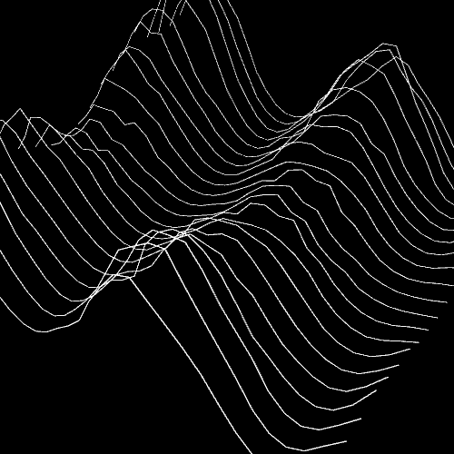

# Honorable-alphabet
I hate sacrificing things


```javascript
setup = (_) => createCanvas((w = 500), w, WEBGL);
k = 0;
a = 0;
draw = (_) => {
  clear();
  rotateX(0.9);
  rotateZ(0.6);
  h = w / 2;
  for (j = -h + k; j < h + k; j += 24) {
    noFill();
    stroke(h);
    beginShape();
    for (i = -h; i < h; i += 16) {
      vertex(
        i,
        j,
        map(sin(map(i, -h, h, -6, 6)), -1, 1, 0, h * noise(i / 99, j / 99))
      );
    }
    endShape();
  }
  k += 0.2;
  if (k > 24) {
    k = 0;
  }
  if (a == 0) {
    saveGif("xp088.gif", 666, { delay: 0, units: "frames" });
  }
  a++;
};
